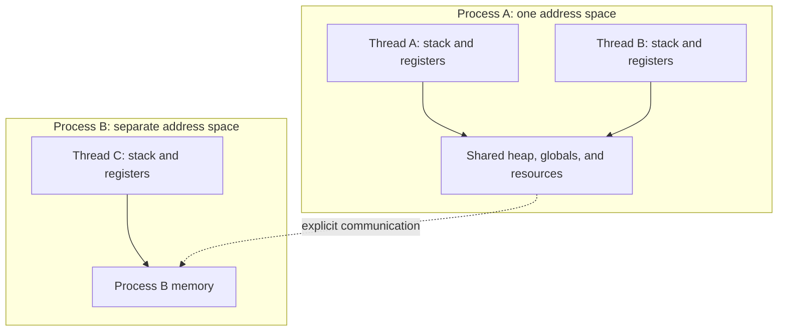
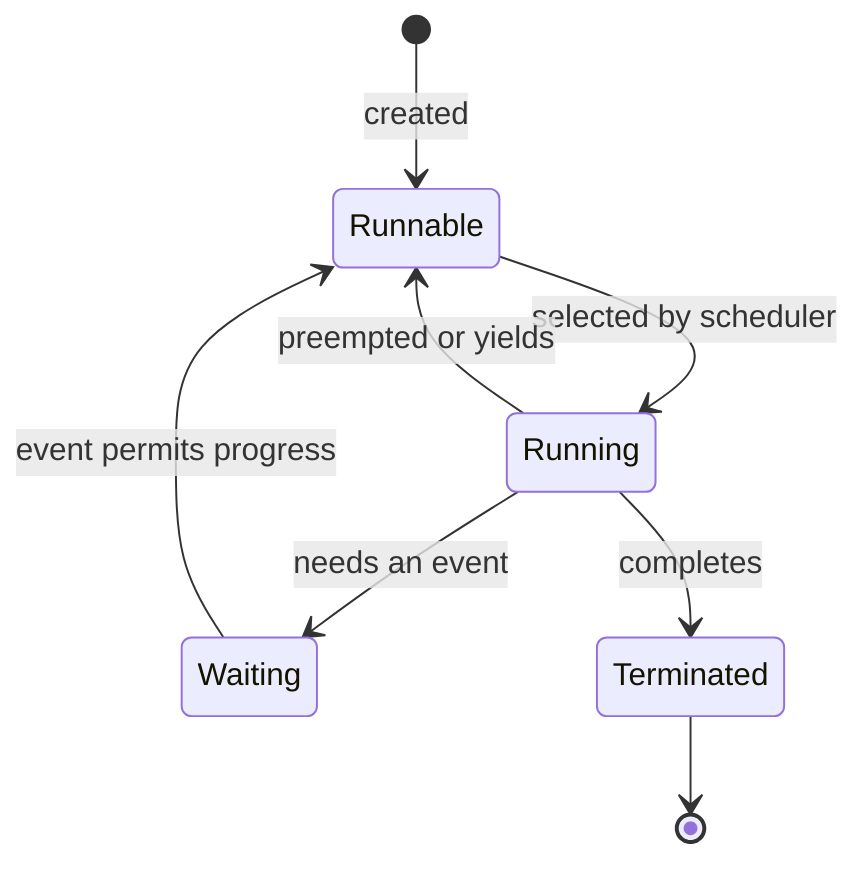

# 01. Processes & Threads

[Home](../README.md) · [Roadmap](../ROADMAP.md) · [Concept map](../CONCEPT-MAP.md)

**Layer:** OS foundations

**Estimated study time:** 45–60 minutes including exercises

**Status:** Complete

## Learning Objectives

By the end of this lesson, you can:

- Distinguish a program, a process, an OS thread, and an application task.
- Draw the resource boundary of a process and identify what its threads share.
- Explain why multiple threads do not guarantee parallel execution.
- Trace simple schedules without assuming an execution order that was never guaranteed.
- Observe processes and threads on Linux and explain the limits of that observation.

## Prerequisites

You should know what a function, variable, and CPU are. No concurrency API or particular programming language is required. The examples use non-executable pseudocode; one optional observation exercise uses Bash and Linux `ps` from procps-ng.

## The Problem

Imagine a backend that accepts a request, validates it, sends a database query, waits for the result, and builds a response. A second request arrives during the wait.

Where can that second request execute? Can it use the same memory? Does starting another thread mean another CPU is available? If one request waits, does the whole application stop?

Before choosing virtual threads, goroutines, futures, or an event loop, we need to name the resources and execution contexts involved. This chapter establishes those names. It does not yet choose a server architecture.

## How It Works

### 1. A program is not a process

A **program** is code and associated data that can be executed. A **process** is a running execution environment with resources such as an address space and handles to files or other OS objects. Starting the same program twice can create two processes. A **thread** is a flow of execution within a process; it carries execution state such as registers and a stack. Microsoft's [process and thread overview](https://learn.microsoft.com/en-us/windows/win32/procthread/about-processes-and-threads) describes this distinction in the Windows model.

Consider two copies of a backend service. They may execute identical code, but a variable named `requestCount` in one process is not automatically the same mutable variable in the other. Naming something identically does not connect its storage.

A request, by contrast, is a unit of application work. There is no universal rule that one request creates one thread or one process. The execution model determines how requests use those resources.

### 2. What belongs to the process, and what belongs to a thread?

Think of a process as a **resource and execution container**. Here, “container” is a teaching analogy, not a claim that a process is a Docker container or a complete security sandbox.

A typical native-process memory layout includes:

| Region or resource | Purpose | Important qualification |
| --- | --- | --- |
| Code, often called text | Executable instructions | Read-only code pages may be shared physically between processes. |
| Data | Global and static storage | Ordinary mutable data is private to the process unless explicitly shared. |
| Heap | Dynamically allocated storage | Threads in the process can refer to the same allocations. |
| Stacks | Function calls and local execution data | A multithreaded process has separate thread stacks, not one stack used by every thread. |
| Open files and other handles | Access to OS-managed resources | Exact sharing and inheritance rules depend on the OS and resource. |

The **execution context** is the state needed to resume an execution flow, including its program counter (PC) and registers. A single-threaded process has one such flow. In a multithreaded process, each thread needs its own context.

Textbooks often call the OS's process bookkeeping a **Process Control Block (PCB)** and per-thread bookkeeping a **Thread Control Block (TCB)**. These are conceptual names, not portable APIs or a requirement that every OS stores everything in exactly two structures. Process identity and resources belong to the process model; resumable execution state belongs to each thread. Scheduling metadata is associated with the schedulable entity in that OS.

### 3. A process provides a memory boundary

Each process normally has its own virtual address space. Processes can deliberately communicate through mechanisms such as pipes, sockets, or shared-memory mappings. Isolation of ordinary memory does not mean they cannot affect the same database row, file, or external service.

A useful Linux example is `fork()`: parent and child have separate memory spaces even though their initial contents match. Ordinary writes in one do not update the other's private memory. Linux uses copy-on-write pages, so separate address spaces do not require eagerly copying every physical page. Inherited file descriptors can still refer to the same underlying open file description. See [`fork(2)`](https://man7.org/linux/man-pages/man2/fork.2.html).

For now, distinguish **private memory** from **shared external resources**. Two service processes can each have a private cache and still compete for the same database connection limit.

### 4. Threads share the process, but have separate execution state

In the POSIX thread model, threads in a process share global/heap memory and process-wide resources such as open file descriptors. Each has its own stack and thread-specific state. See [`pthreads(7)`](https://man7.org/linux/man-pages/man7/pthreads.7.html).

| Item | Relationship between threads in one process |
| --- | --- |
| Code and global/heap memory | Shared address space |
| Open file descriptors in POSIX | Shared process-wide resources |
| Stack and current function calls | Separate per thread |
| Register state and instruction position | Separate execution context |
| Referenced mutable object | Can be accessed by multiple threads |

A separate stack does not make every object accessed through it private. Two local variables can point to the same heap object. Likewise, separate stacks are not a security boundary: in native shared-address-space code, another thread may access a stack location if it has a valid pointer and the program's rules permit it.

The design question is ownership: **which execution contexts can access this state, and what coordinates their access?** Do not infer ownership merely from where a variable is declared.

### 5. Runnable, running, and waiting are different

For the simplified OS-thread model used here:

- **Runnable:** eligible for CPU execution, possibly waiting to be selected.
- **Running:** currently executing on a logical CPU.
- **Waiting/blocked:** cannot proceed until an event, such as I/O completion or lock availability.
- **Terminated:** execution has ended.

The familiar textbook process lifecycle, new → ready → running → waiting → ready → … → terminated, is a simplified starting point for a single execution flow. In a multithreaded process, one thread may be running while another waits; one process-wide label cannot capture every thread's state.

These are teaching labels, not an exact enumeration of every OS state. Linux's scheduler selects runnable threads according to policy and priorities; see [`sched(7)`](https://man7.org/linux/man-pages/man7/sched.7.html). A context switch changes the execution context using a CPU. A switch does not create more CPU capacity.

On one available logical CPU, two OS threads can take turns. On multiple available logical CPUs, eligible threads may execute simultaneously. Neither creating threads nor declaring work independent guarantees a particular schedule. Available CPU capacity may also be constrained by affinity, quotas, and competing workloads.

This gives us a preview of two core concepts: **concurrency** concerns overlapping progress; **parallelism** concerns simultaneous execution. Both processes and threads can participate in either, depending on the environment.

### 6. A thread can wait without the entire process waiting

If one OS thread blocks while another is runnable, the second may execute. But if the second needs a lock held by the first, it may have to wait too. More threads do not automatically remove dependencies.

An OS thread can end while other threads continue. In POSIX, a new thread's start routine returning ends that thread; process-level exit ends the process's threads. See [`pthread_create(3)`](https://man7.org/linux/man-pages/man3/pthread_create.3.html). Runtime lifecycle rules may add further behavior.

Shared resources also mean shared failure impact. An uncaught application exception may be contained by a runtime, but a process-fatal error can terminate all its threads. Threads are not strong fault-isolation boundaries.

### 7. Cooperation between processes and the motivation for threads

**Interprocess communication (IPC)** lets processes exchange information or coordinate work. Two broad approaches are:

- **Message passing:** transfer information through a mechanism such as a pipe or socket. Applications still need rules for message framing, ownership, ordering, and failure handling.
- **Shared memory:** deliberately map memory so multiple processes can access it. Sharing the bytes does not make compound updates atomic or remove the need for synchronization.

**Producer–consumer** describes a cooperation pattern, not a third IPC mechanism. A producer supplies work or data and a consumer handles it. The pattern can use messages or a shared-memory buffer; it can also occur between threads in one process.

For example, two service processes can exchange booking IDs over a local socket. Alternatively, threads within one service can access the same in-memory work queue. Either design needs a policy for an empty queue, a full queue, and shutdown. The appropriate mechanism depends on the ownership and isolation required.

Threads are useful because they can keep independent work responsive while another activity waits, share process resources directly, and make parallel execution possible when CPU capacity and the workload permit it. Creating and coordinating threads often costs less than doing the equivalent with separate processes, but the cost depends on the OS, runtime, and workload. Shared memory introduces coordination costs of its own. “Cheaper” is a tradeoff to measure, not a guarantee of faster execution.

### 8. Runtime tasks are another layer

This lesson uses **OS thread** explicitly. A language runtime can schedule many application activities over fewer OS threads. Do not transfer the OS-thread state diagram unchanged to every runtime abstraction.

| Language | Preview of the runtime distinction |
| --- | --- |
| Java | Platform threads and virtual threads have different scheduling relationships with OS threads; virtual threads use carrier threads. See the [Java 21 guide](https://docs.oracle.com/en/java/javase/21/core/virtual-threads.html). |
| Go | Goroutines are multiplexed onto OS threads by the runtime. See the [Go FAQ](https://go.dev/doc/faq#goroutines). |
| Scala | A `Future` schedules computation through an `ExecutionContext`; it does not imply a new dedicated thread per future. See [Futures and Promises](https://docs.scala-lang.org/overviews/core/futures.html). |
| JavaScript | Async functions do not by themselves establish parallel JavaScript execution; Node.js also provides explicit worker threads. See [worker threads](https://nodejs.org/api/worker_threads.html). |

These are signposts for later language mappings. First learn to ask: **is this an OS thread, or work a runtime schedules onto one?**

### 9. User-level execution and kernel scheduling

The OS schedules kernel-visible execution contexts. A user-space runtime or library may schedule additional execution flows over those contexts. The word “thread” is used at both layers, so always identify the layer.

In the following textbook notation, **M** is the number of user-level execution flows and **N** is the number of underlying kernel-scheduled threads:

| Mapping | Meaning | Parallelism and blocking |
| --- | --- | --- |
| M:1 | Many user-level flows use one kernel thread. | Those flows cannot execute CPU instructions in parallel with one another. A call that blocks the only underlying kernel thread prevents all of them from executing until that thread can run again. Runtime-aware nonblocking I/O may suspend just one user-level flow instead. |
| 1:1 | Each user thread maps to one kernel thread. | Multiple runnable threads can execute in parallel if CPU capacity is available. A blocked thread need not stop the others. Neither parallel execution nor a speedup is guaranteed. |
| M:N | Many user-level flows are multiplexed over multiple kernel threads. | Runtime scheduling and OS scheduling both matter. Parallelism depends on runnable work and available underlying threads/CPUs; blocking behavior depends on how the runtime handles the operation. |

Go goroutines illustrate runtime multiplexing, as described in the [Go FAQ](https://go.dev/doc/faq#goroutines). Java virtual threads also distinguish runtime scheduling from carrier-thread execution. These are useful connections to the M:N idea, not a claim that their schedulers, preemption, or blocking rules are identical.

Keep the boundaries visible: a process owns resources, an OS thread supplies an execution context the OS can schedule, and a runtime may add its own schedulable activities. The next chapter examines CPU scheduling; the later execution-model chapter develops these mappings in depth.

## Visual Model

### Resource ownership



Arrows inside a process represent access to its resources. The dotted arrow represents a deliberate communication mechanism, not ordinary access to the other process's private variables. This drawing omits runtime tasks, memory permissions, and explicitly shared mappings.

### Simplified thread state transitions



An event makes a waiting thread eligible again; it does not guarantee immediate CPU execution. A real OS may expose additional states, and termination can occur through paths omitted from this teaching model.

## Practical Examples

### Example 1: Two threads, one shared result

Assume `start_os_thread` creates an OS thread, and `join` waits for its completion and makes its prior writes visible to the joining thread. `print_line` writes one complete line. `print_line` calls from different threads can occur in either order.

```text
shared result = 0

worker = start_os_thread:
    result = 42
    print_line("worker finished")

print_line("main continues")
join(worker)
print_line(result)
```

There are two threads: the initial thread and the worker. Under these assumptions, either message can appear first, but the final line is `42`. The initial thread prints the result only after the worker completes. There is no concurrent read/write of `result` in this example.

Joining is not polling the variable until it changes. It coordinates completion. If you remove the join, neither completion nor visibility follows from the remaining code; the actual language's memory and lifecycle rules become essential.

### Example 2: The lost update is a schedule, not magic

For this teaching model only, assume each read and write of `counter` is atomic and sequentially consistent. The compound increment is explicitly **not** atomic.

```text
shared counter = 0

thread A:                 thread B:
    a = read(counter)         b = read(counter)
    a = a + 1                 b = b + 1
    write(counter, a)         write(counter, b)
```

One valid schedule is:

| Step | Action | Shared counter |
| --- | --- | --- |
| 1 | A reads 0 into a | 0 |
| 2 | B reads 0 into b | 0 |
| 3 | A computes a = 1 and writes 1 | 1 |
| 4 | B computes b = 1 and writes 1 | 1 |

Two increments produced `1`. If A completes its increment before B reads, the result is `2`. This can happen with time-sliced execution on one logical CPU; simultaneous execution is not required.

This deliberately constrained model explains a lost update. It is not a promise that unsynchronized code in every real language has only those two outcomes. Real memory models may provide different guarantees or make a data race undefined. Synchronization and memory-model chapters will establish the applicable rules.

### Example 3: Observe Linux processes and threads

On Linux with procps-ng, these are read-only snapshots:

```bash
ps -e -o pid,ppid,comm,nlwp
ps -eL -o pid,tid,comm,stat
```

`PID` identifies a process, `PPID` its parent, and `NLWP` reports its thread count. The second command shows thread-level rows, including thread IDs. Several rows with one PID represent threads in the same process. Output depends on permissions, namespaces, and what is alive at the moment. Consult [`ps(1)`](https://man7.org/linux/man-pages/man1/ps.1.html) for field definitions.

To observe one known process without guessing its ID, run this in Bash:

```bash
sleep 30 &
handbook_pid=$!
ps -p "$handbook_pid" -o pid,ppid,comm,nlwp
ps -L -p "$handbook_pid" -o pid,tid,comm,stat
wait "$handbook_pid"
unset handbook_pid
```

This launches only a short-lived child process; it ends automatically. Typical Linux `sleep` implementations show one thread. The invariant is that you inspect the PID you just launched. The numeric PID and state can vary. `wait` reaps that child; there are no generated files or services to clean up.

A snapshot cannot prove two threads executed simultaneously, show every brief state transition, or enumerate runtime tasks such as goroutines. A process's thread count is not its number of requests in progress.

## Common Misconceptions

| Claim | Correction |
| --- | --- |
| A program and a process are the same thing. | One program can have multiple running instances, each with its own process resources. |
| Every request gets its own thread. | That is one possible execution model, not an OS rule. |
| Every thread gets a CPU core. | Runnable threads compete for available CPU execution capacity. |
| More threads always make work faster. | Dependencies, contention, scheduling overhead, and resource limits can dominate. |
| A local variable makes the referenced object thread-private. | Local references on separate stacks can point to one shared object. |
| A blocked thread means the whole process is blocked. | Other runnable threads may progress unless dependencies prevent them. |
| A race requires two cores. | Interleaved read-modify-write steps can lose updates on one logical CPU. |
| Separate processes cannot affect each other. | They can communicate and contend for shared external resources. |

## Exercises

### Conceptual Questions

1. A service starts a second process. Both allocate a private variable called `cache`. Does changing one cache automatically change the other? What if both write the same database row? If they deliberately share a memory region, is synchronization still necessary? Is producer–consumer itself an IPC mechanism?
2. Threads A and B each have a local reference to the same booking object. Which parts are separate, and which are shared?
3. There are 100 runnable OS threads and one available logical CPU. Does that imply 100-way parallel execution? Can the threads still make concurrent progress? How would the answer change for M user-level flows mapped to one kernel thread, and what happens if a call blocks that underlying thread?
4. Thread A waits for I/O while holding a lock that B needs. Why might B fail to progress even if a CPU is available?

### Predict the Output

5. Using Example 1's `start_os_thread`, `join`, and line-printing assumptions:

   ```text
   worker = start_os_thread:
       print_line("A")
       print_line("B")
   print_line("M")
   join(worker)
   print_line("J")
   ```

   List every valid line order. Must `A` appear before `M`? Can `J` appear before `B`?

6. In Example 2's atomic, sequentially consistent read/write model, give a schedule producing `2`. Explain exactly what ordering prevents the lost update in that schedule. Does observing `2` once prove the code is safe?

### Hands-on Tasks

7. Run the short-lived Linux process example. Record PID, PPID, NLWP, and the number of thread rows. Explain which values could change on the next run.
8. Use the read-only system-wide snapshot to find a process with multiple threads, if one is visible. Explain why its thread count alone cannot reveal CPU parallelism or request concurrency. If none is visible, explain why the snapshot does not establish that all programs are single-threaded.
9. Draw a backend with two worker threads sharing an in-memory cache and a second service process with its own cache. Add a database both processes use. Mark every resource that can be accessed from more than one execution context.

### Answer Guidance

<details>
<summary>Open after attempting the exercises</summary>

1. Ordinary private memory is separate. The same database row is an external shared resource, so the processes can still conflict there. Deliberately shared mappings would change the memory assumption, but shared bytes still need coordination when accesses conflict. Producer–consumer is a cooperation pattern that can use different IPC mechanisms.
2. Each thread has its own local reference storage and execution state; both references identify one shared booking object. Safe access depends on ownership, mutability, and coordination.
3. At most one of those OS threads executes on that one logical CPU at an instant in this model. They can make concurrent progress by taking turns, subject to scheduling and dependencies. Runnable does not mean guaranteed prompt progress. M:1 user-level flows likewise cannot execute CPU instructions in parallel with one another; blocking their sole kernel thread stops their execution until it can run again. Suspending one flow through runtime-aware I/O is a different case.
4. B needs the lock, not just CPU time. Available CPU capacity cannot satisfy an unmet dependency.
5. `A B M J`, `A M B J`, and `M A B J`. Worker program order puts A before B. The join puts J after worker completion, and M is before the join in the initial thread. A need not precede M; J cannot precede B.
6. A reads 0, computes and writes 1; then B reads 1, computes and writes 2. B reads after A's write in that particular schedule. Nothing in the pseudocode guarantees that ordering on another run, so observing 2 is not proof of correctness.
7. The recorded PID should match the child launched through `$!`; PPID should identify the launching Bash process. A typical sleep shows NLWP = 1 and one thread row. IDs and state are observations, not portable constants; inspect errors if the process has already exited.
8. Multiple rows demonstrate multiple OS threads associated with one visible process. They do not show simultaneous execution, runnable work, or runtime task counts. A snapshot has limited visibility and captures only one moment.
9. The first cache is shared between its two workers. The second cache is separate ordinary process memory. The database is shared externally across both processes. Mark separate thread execution state inside each process and label any explicit communication you introduce.

</details>

## References

- [Microsoft Learn: About Processes and Threads](https://learn.microsoft.com/en-us/windows/win32/procthread/about-processes-and-threads): program/process/thread distinction and Windows resources.
- [Linux man-pages: pthreads(7)](https://man7.org/linux/man-pages/man7/pthreads.7.html): shared process attributes and per-thread state in POSIX.
- [Linux man-pages: fork(2)](https://man7.org/linux/man-pages/man2/fork.2.html): separate address spaces, inheritance, and Linux copy-on-write behavior.
- [Linux man-pages: sched(7)](https://man7.org/linux/man-pages/man7/sched.7.html): OS scheduling policies and runnable threads.
- [Linux man-pages: pthread_create(3)](https://man7.org/linux/man-pages/man3/pthread_create.3.html): thread creation and termination behavior.
- [procps-ng: ps(1)](https://man7.org/linux/man-pages/man1/ps.1.html): Linux observation options and fields.
- [Oracle: Java 21 Virtual Threads](https://docs.oracle.com/en/java/javase/21/core/virtual-threads.html), [Go FAQ: goroutines](https://go.dev/doc/faq#goroutines), [Scala: Futures and Promises](https://docs.scala-lang.org/overviews/core/futures.html), and [Node.js: worker threads](https://nodejs.org/api/worker_threads.html): runtime distinctions previewed above. Runtime details belong in the language mappings.

Next in the [roadmap](../ROADMAP.md): CPU & Scheduling. We will examine how runnable work gets CPU time before comparing concurrency and parallelism in depth.
