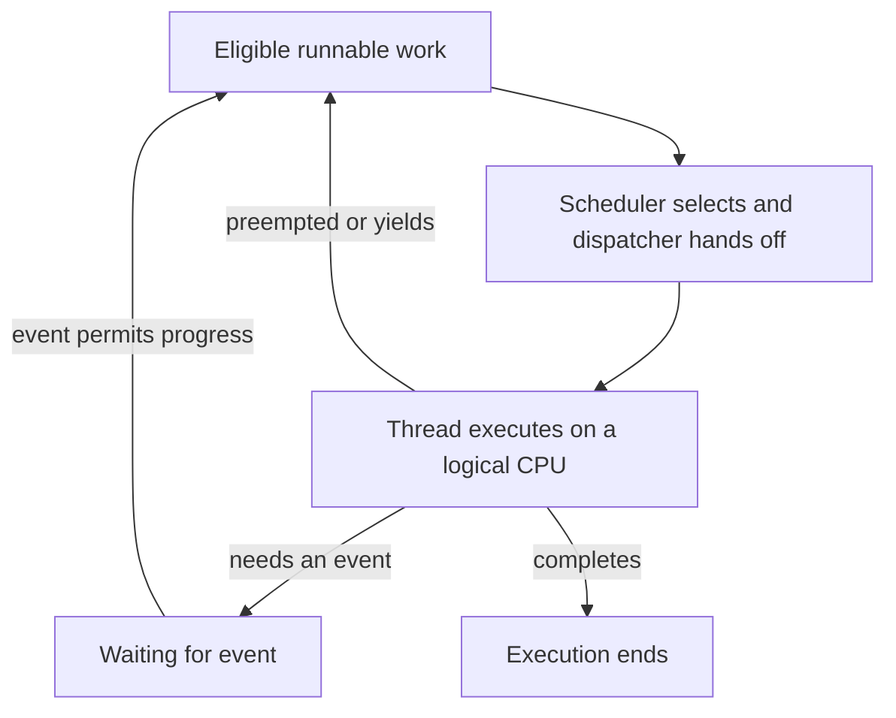

# 02. CPU & Scheduling

[Home](../README.md) · [Roadmap](../ROADMAP.md) · [Previous: Processes & Threads](01-processes-and-threads.md)

**Layer:** OS foundations

**Estimated study time:** 60–90 minutes including exercises

**Status:** Complete

## Learning Objectives

By the end of this lesson, you can:

- Distinguish a physical core, a logical CPU, and CPU capacity actually available to an application.
- Explain selection, dispatch, preemption, blocking, and wakeup without confusing them.
- Calculate response, waiting, and turnaround times for a declared scheduling model.
- Trace FCFS, SJF, SRTF, priority scheduling, Round Robin, and a simple feedback queue.
- Explain why load balancing, affinity, quotas, and runtime scheduling affect backend behavior.

## Prerequisites

Read [Processes & Threads](01-processes-and-threads.md), especially runnable versus running and the distinction between OS threads and runtime tasks. You only need arithmetic for the worked schedules. No particular language or privileged OS configuration is required.

## The Problem

A backend has three runnable activities: a long report calculation, a medium-sized validation batch, and a short health check. All need CPU time. One logical CPU is available.

Starting three threads makes three execution contexts eligible to run. It does not answer which runs first, how long it keeps the CPU, or how long the health check waits. Different scheduling policies can finish the same total CPU work in the same elapsed time while giving users very different experiences.

The scheduler allocates execution opportunities. To reason about its choices, first specify the workload, the policy, and the metric you care about.

## How It Works

### 1. CPU capacity is more than a core count

A **physical core** contains hardware execution resources. A **logical CPU** is a hardware execution context exposed to the OS. With simultaneous multithreading (SMT), a core can expose multiple logical CPUs that share physical resources. Two logical CPUs do not imply twice the throughput of one core.

For this chapter's scheduling model, one OS thread occupies one logical CPU at an instant. Multiple logical CPUs allow simultaneous execution of multiple threads, but speedup depends on the workload and shared bottlenecks.

CPU capacity available to your process can be smaller than the machine's total:

- An affinity mask can restrict where a thread is eligible to run.
- Other runnable work competes for CPU time.
- A CPU bandwidth quota can restrict how much execution time a group receives.
- Threads can be waiting for I/O or locks rather than being runnable.

A group with a quota equivalent to one CPU is not necessarily pinned to one logical CPU. A bandwidth limit controls time over a period; affinity controls placement. On Linux, the CPU controller's [documentation](https://github.com/torvalds/linux/blob/master/Documentation/admin-guide/cgroup-v2.rst) describes these separate resource controls. Record both when interpreting measurements.

### 2. Selection, dispatch, and preemption

A **short-term scheduler** selects eligible execution work. The **dispatcher** performs the handoff that allows the selected context to execute. A **context switch** saves/restores execution state when the CPU switches between contexts. These are related ideas, not three names for the same decision.

A ready queue is a useful model of eligible work. Real systems can use several queues or other structures, including per-CPU structures and distinct scheduling classes. A thread can also be eligible in principle but temporarily unable to execute because its group has exhausted a bandwidth budget.

A running thread can:

- **Complete** its work or terminate.
- **Block** because progress requires an event, such as I/O completion.
- **Yield** voluntarily, without a general guarantee about which thread runs next.
- Be **preempted**, allowing other eligible work to run.

A wakeup makes progress possible again; it does not reserve a CPU. A timer interrupt can trigger scheduling work, but an interrupt does not necessarily cause a switch to another thread.

**Nonpreemptive scheduling** lets a selected job run until it blocks or completes in the simplified model. **Preemptive scheduling** can take CPU time away from a still-runnable job, for example when its quantum expires or higher-priority work becomes eligible.

### 3. Define the metrics before comparing policies

For a job, define arrival time A, first execution time S, and completion time C. A CPU burst is a period of CPU work before blocking or completing.

| Metric | Meaning in this chapter |
| --- | --- |
| Response time | S − A: time until the job first gets CPU service |
| Turnaround time | C − A: time from arrival until completion |
| Waiting time | Total time ready but not executing |
| Throughput | Completed jobs divided by the observation interval |
| CPU utilization | Fraction of the stated CPU capacity busy during the interval |

For a job with one CPU-only burst of length B and no overhead, waiting time = turnaround time − B. Do not use that shortcut unchanged for jobs that also block on I/O.

The [OSTEP authors' scheduling simulator](https://github.com/remzi-arpacidusseau/ostep-homework/blob/master/cpu-sched/README.md) uses these scheduling metrics. A backend's “response latency” normally means request-to-response elapsed time, not merely the scheduling metric S − A.

A policy can reduce average waiting while delaying one long job, or improve first service while increasing completion times. An average also hides outliers. State whether you care about fairness, mean completion, tail latency, deadlines, or some combination.

### 4. FCFS: run in arrival order

**First-Come, First-Served (FCFS)**, also called FIFO in the basic model, selects jobs in arrival order and runs them nonpreemptively.

It is easy to explain, but a short job behind a long CPU burst waits for that burst. This is the **convoy effect**: work accumulates behind a long-running activity. A FIFO ready queue by itself is not the same thing as an entire system's scheduling policy.

Example: if a report needs 80 time units and a health check needs 1, arrival order can make the health check wait almost 80 units before its first service.

### 5. SJF and SRTF: favor shorter work

**Shortest Job First (SJF)** selects the ready job with the shortest next CPU burst and runs it nonpreemptively. It does not interrupt a running burst just because a shorter job arrives.

For independent jobs all available at time zero, with known single CPU bursts, one CPU, and no switching cost, ordering bursts shortest-first minimizes average waiting time. A simple exchange argument explains why: placing a shorter burst before a longer one reduces their combined waiting without delaying jobs after the pair.

**Shortest Remaining Time First (SRTF)** is the preemptive counterpart: compare remaining CPU work and allow a shorter arrival to preempt. Under the idealized single-CPU model with known job sizes, release times, and cost-free preemption, it minimizes mean completion/turnaround time for that workload.

Real OSes generally do not know the exact length of the next burst in advance. Estimating it, deciding how to treat I/O, and paying switching costs change the problem. “Shortest is optimal” needs its assumptions and objective attached. A continuing stream of short arrivals can also postpone long work.

### 6. Priority scheduling and aging

Priority scheduling favors higher-priority eligible work. It may be preemptive or nonpreemptive; define which, and define how ties are broken. Do not assume that a larger numeric value always means a higher priority.

A low-priority job can suffer **starvation** if higher-priority work continually wins. **Aging** raises the priority of waiting work to mitigate this. Whether it gives a useful waiting-time guarantee depends on the actual policy and workload.

Priorities also do not resolve dependencies. If a high-priority thread needs a lock held by a lower-priority thread, merely selecting high-priority work cannot make the lock available. Priority inversion and its remedies require additional coordination reasoning; the synchronization chapter will develop that topic.

### 7. Round Robin: bound each turn

**Round Robin (RR)** cycles through ready jobs. Each receives up to a **time quantum**, q, before it is placed at the back of the queue if it is still runnable. A job that finishes or blocks earlier gives up its turn earlier.

With a fixed finite ready set, RR gives each member recurring service. Smaller quanta can improve time to first service, but excessive switching can consume time and disturb useful cache state. Large quanta make behavior approach FCFS for a batch of CPU-only jobs.

A quantum is not a guarantee that a task completes within q. It is a limit on one scheduled turn in this model.

If every full q units of useful CPU work incur s units of switching overhead, a simple illustrative useful-work fraction is q / (q + s). Real costs vary; a quantum boundary with no other runnable job need not involve switching to another thread. CPU utilization can count overhead as busy time even when that overhead does no application work.

### 8. Multilevel queues and feedback

A **multilevel queue** scheduler assigns work to queues with different policies or priorities, for example interactive versus batch work. The design needs both a policy within a queue and a policy between queues. Strict preference for one queue can starve another.

A **Multilevel Feedback Queue (MLFQ)** additionally moves work between levels based on observed behavior. One teaching policy is:

1. Admit new work at the highest priority.
2. Run the highest nonempty queue; use RR within each level.
3. After a job uses its CPU allotment at a level, demote it.
4. Periodically boost waiting/runnable work according to a declared rule.

The intent is to give newly arrived or short-burst work early service without knowing exact burst lengths. An implementation must define what I/O does to priority and how CPU usage is accumulated. Resetting the entire allotment after every early yield can let a task game the policy. The [OSTEP MLFQ simulator](https://github.com/remzi-arpacidusseau/ostep-homework/blob/master/cpu-sched-mlfq/README.md) exposes these choices explicitly.

An allotment can span several quanta: the quantum limits one turn; the allotment limits cumulative CPU service before a priority change. They are not necessarily equal.

MLFQ is an influential model, not the universal scheduler of modern OSes. For a concrete counterexample, Linux's source documentation discusses [CFS](https://github.com/torvalds/linux/blob/master/Documentation/scheduler/sched-design-CFS.rst) and its evolution toward [EEVDF](https://github.com/torvalds/linux/blob/master/Documentation/scheduler/sched-eevdf.rst). Those fair-scheduling designs are not simply the textbook MLFQ above. Other scheduling classes and installed kernel versions need their own documentation. In particular, Linux's real-time policies named SCHED_FIFO and SCHED_RR have class and priority rules; do not equate their complete behavior with the classroom FIFO/RR examples here.

### 9. Multiprocessor scheduling

With multiple logical CPUs, the scheduler chooses both **what runs** and **where it runs**.

| Idea | Benefit | Tradeoff or limit |
| --- | --- | --- |
| Load balancing | Move runnable work toward available CPU capacity | Migration and coordination have costs; eligibility constraints may prevent movement. |
| Affinity | Preserve eligibility on selected CPUs or favor recent placement | Hard pinning can leave one CPU overloaded while another is idle. |
| Per-CPU queues | Reduce contention on a single shared scheduling structure | Work can become unevenly distributed. |
| Shared queue | Make globally ready work visible to participating CPUs | Shared queue coordination can become costly. |

Keeping a thread near recently used data can help cache locality. Moving it may still be better than leaving it waiting behind an overloaded CPU. The [OSTEP multiprocessor simulator](https://github.com/remzi-arpacidusseau/ostep-homework/blob/master/cpu-sched-multi/README.md) illustrates this balancing/locality tradeoff with an explicitly simplified cache model.

**Symmetric multiprocessing (SMP)** treats processors as peers for OS execution roles. **Asymmetric multiprocessing (AMP)** assigns distinct roles, such as a controlling processor and processors dedicated to particular work. These describe system organization; neither specifies a single ready-queue algorithm.

Do not confuse SMP/AMP with SMT, or assume that a processor with different core types must use AMP. Physical core capabilities and OS responsibility are different dimensions.

### 10. Runtime scheduling is a separate decision

An OS can schedule a runtime's thread while a particular application task still waits inside that runtime. For example, a runnable worker thread may be busy with one callback while another callback is queued behind it.

Conversely, creating many runtime tasks does not make all of them runnable OS threads. Before blaming the OS scheduler, identify where work is queued: application admission, runtime scheduler, OS run queue, lock, or external dependency.

## Visual Model

This is a conceptual flow, not the exact data structures of a particular OS. Affinity, quotas, priorities, and scheduling classes can restrict eligibility. Multiple CPUs can be executing different threads while this cycle continues.

For exact single-CPU timelines, use the interval tables below. They make durations and boundary rules explicit.

## Practical Examples

### Example 1: One workload, three policies

Assume one logical CPU; jobs A, B, and C arrive together at time 0 in that order. They need 8, 4, and 2 CPU-time units respectively. There is no I/O, no external competition, no switching overhead, and no dependency between jobs.

For FCFS, preserve arrival order. For SJF, choose the shortest burst. For RR, use q = 2, initial order A/B/C, and append an unfinished job to the back of the queue after its turn. Intervals are start-inclusive and end-exclusive.

| Policy | Execution intervals |
| --- | --- |
| FCFS | A [0,8), B [8,12), C [12,14) |
| SJF | C [0,2), B [2,6), A [6,14) |
| RR, q = 2 | A [0,2), B [2,4), C [4,6), A [6,8), B [8,10), A [10,12), A [12,14) |

The final two RR turns belong to A because no other job remains. They do not imply that a real OS must switch to a different thread at time 12.

| Policy | Job | First service | Completion | Response | Waiting | Turnaround |
| --- | --- | --- | --- | --- | --- | --- |
| FCFS | A | 0 | 8 | 0 | 0 | 8 |
| FCFS | B | 8 | 12 | 8 | 8 | 12 |
| FCFS | C | 12 | 14 | 12 | 12 | 14 |
| SJF | A | 6 | 14 | 6 | 6 | 14 |
| SJF | B | 2 | 6 | 2 | 2 | 6 |
| SJF | C | 0 | 2 | 0 | 0 | 2 |
| RR | A | 0 | 14 | 0 | 6 | 14 |
| RR | B | 2 | 10 | 2 | 6 | 10 |
| RR | C | 4 | 6 | 4 | 4 | 6 |

For RR's A, waiting is 14 − 8 = 6. Its first service is immediate, but its completion is delayed by the other jobs' turns.

| Policy | Mean response | Mean waiting | Mean turnaround |
| --- | --- | --- | --- |
| FCFS | 20/3 ≈ 6.67 | 20/3 ≈ 6.67 | 34/3 ≈ 11.33 |
| SJF | 8/3 ≈ 2.67 | 8/3 ≈ 2.67 | 22/3 ≈ 7.33 |
| RR | 2 | 16/3 ≈ 5.33 | 10 |

All three complete 3 jobs by time 14, giving throughput 3/14 jobs per time unit over [0,14), and 100% CPU utilization under these assumptions. Equal throughput does not imply equal waiting or responsiveness.

### Example 2: A short arrival cannot preempt nonpreemptive SJF

Now A arrives at time 0 needing 8 units, and B arrives at time 1 needing 2. Keep the other one-CPU, no-I/O, zero-overhead assumptions. For SRTF, keep the current job on equal remaining times.

| Policy | Timeline | A turnaround | B turnaround |
| --- | --- | --- | --- |
| Nonpreemptive SJF | A [0,8), B [8,10) | 8 | 9 |
| SRTF | A [0,1), B [1,3), A [3,10) | 10 | 2 |

At time 1, A has 7 units left. SRTF lets B run because 2 is less than 7. Nonpreemptive SJF cannot interrupt A's current burst. SRTF reduces this workload's mean turnaround from 8.5 to 6, while A itself finishes later.

### Example 3: CPU quota and placement are different

Suppose a Linux cgroup has a CPU bandwidth budget of 100,000 microseconds per 100,000-microsecond period, with no burst allowance. Two CPU-bound threads are eligible on two logical CPUs. Assume they actually run together and each consumes 50,000 microseconds early in the period.

They have consumed the group's entire 100,000-microsecond aggregate budget after about 50 milliseconds of wall time. They can then be throttled until the budget replenishes, even though other placement restrictions would allow execution.

The ratio describes approximately one CPU's time per period, not a rule that exactly one thread must execute at any instant. This is an illustrative accounting scenario, not a measured trace or a promise of exact kernel timing. Parent-group limits and other work can further restrict service. See the Linux [CPU controller documentation](https://github.com/torvalds/linux/blob/master/Documentation/admin-guide/cgroup-v2.rst).

For a backend, short bursts of parallel execution followed by throttling can affect latency. Increasing worker count does not increase a fixed CPU budget.

## Common Misconceptions

| Claim | Correction |
| --- | --- |
| Sixteen logical CPUs guarantee sixteen cores' worth of throughput. | Logical contexts may share resources, and your process may have additional limits. |
| Ready means running. | Ready work may still wait for CPU service or budget. |
| Every timer interrupt switches to another thread. | A scheduling opportunity need not change the selected thread. |
| SJF always minimizes response latency for any real system. | Its idealized results require a declared workload model and objective. |
| RR guarantees quick completion. | It bounds a turn in the model; repeated turns may be needed. |
| Aging automatically proves a fixed maximum wait. | Guarantees depend on the full policy, arrivals, and capacity. |
| MLFQ is what every modern OS uses. | Real systems use different designs, classes, and version-dependent policies. |
| One CPU of quota means one pinned CPU. | Bandwidth and placement are separate controls. |
| High CPU utilization proves useful application progress. | Switching, spinning, and other overhead may also consume CPU time. |
| More threads always fix a slow request. | The delay may be in a runtime queue, dependency, or exhausted CPU budget. |

## Exercises

### Conceptual Questions

1. Explain why a thread waking after I/O need not run immediately. Is it still waiting for that same I/O while it sits ready?
2. A batch job has good turnaround but an interactive job has poor first-service response. Why might a different policy help one metric while worsening another?
3. Two runnable threads share a quota equivalent to one CPU but can run on four logical CPUs. Must the threads always execute one at a time? How does affinity differ?
4. Why can hard affinity improve locality but worsen completion time? Why is that a separate issue from SMP versus AMP?

### Predict the Output

These are scheduling predictions, not output from an actual OS. Use the exact models stated.

5. For Example 1, change RR to q = 4. Write the intervals, first-service times, completion times, and waiting times.
6. In Example 2, what changes if B needs 7 units instead of 2, using SRTF's keep-current-on-ties rule? State when B first runs.
7. Consider an MLFQ with two levels. New jobs enter the high queue, which always wins over the low queue. High-level quantum and allotment are both 2; low-level RR quantum is 4. No boosts, I/O, arrivals after time 0, or overhead occur. A needs 6 units and B needs 1; initial order is A/B. Give the timeline and each job's completion time.

### Hands-on Tasks

8. Reconstruct the Example 1 table on paper or in a spreadsheet. Verify for every row that waiting + burst = turnaround. Then add 1 time unit of I/O to one job and explain why that identity needs a blocked-time term in the new model.
9. Choose two jobs with equal 3-unit bursts, both arriving at time 0. Trace FCFS and RR with q = 1, breaking ties in arrival order. Calculate mean response and turnaround. Explain the tradeoff.
10. For a backend you know, draw where work can queue before CPU execution. Label application/runtime/OS boundaries and list what evidence would distinguish CPU waiting from I/O waiting. Do not infer the answer from thread count alone.

### Answer Guidance

Open after attempting the exercises

1. The event removes an I/O dependency; scheduling and capacity still determine execution. In this model the thread is ready, not still blocked on that completed I/O. Another dependency may subsequently block it.
2. Giving short or interactive work earlier service can delay a long job's completion. The objective is not determined by CPU utilization alone. Compare per-job and aggregate metrics on the same workload.
3. They can execute together for part of a period and exhaust the group's aggregate budget earlier. Affinity instead limits which logical CPUs are eligible; it does not create an equivalent time budget.
4. Staying near useful cached data can help execution efficiency, but remaining on a busy CPU can mean longer queueing. SMP/AMP concerns processor roles, not whether this particular migration is beneficial.
5. A [0,4), B [4,8), C [8,10), A [10,14). First service: A = 0, B = 4, C = 8. Completion: A = 14, B = 8, C = 10. Waiting: A = 6, B = 4, C = 8. Arrival times are all zero.
6. At time 1, both have 7 units left. Keeping the current job makes A continue through time 8. B first runs at 8 and completes at 15.
7. A [0,2) uses its high allotment and is demoted. B [2,3) completes in the high queue. A [3,7) completes in the low queue. Completion: B = 3, A = 7.
8. The supplied CPU-only table satisfies the identity in every row. With blocked time, turnaround includes time that is neither CPU service nor ready-queue waiting. Adding I/O can also change subsequent scheduling, so do not merely add 1 to every original completion time.
9. FCFS: A [0,3), B [3,6); response times 0 and 3, mean 1.5; turnarounds 3 and 6, mean 4.5. RR: A [0,1), B [1,2), A [2,3), B [3,4), A [4,5), B [5,6); responses 0 and 1, mean 0.5; turnarounds 5 and 6, mean 5.5. Earlier first service came with a larger mean completion delay here.
10. A useful diagram distinguishes admitted requests, queued runtime tasks, runnable OS threads, and blocked dependencies. Evidence might include runtime queue lengths, CPU time, scheduler delay, throttling counters, or blocked-thread/I/O traces. Each metric answers a different question; no single fixed observation is required.

## References

- [OSTEP authors: CPU scheduling simulator](https://github.com/remzi-arpacidusseau/ostep-homework/blob/master/cpu-sched/README.md): primary teaching material for FIFO/SJF/RR and scheduling metrics. The worked schedules here use their own explicitly declared workloads.
- [OSTEP authors: MLFQ simulator](https://github.com/remzi-arpacidusseau/ostep-homework/blob/master/cpu-sched-mlfq/README.md): quanta, allotments, boosts, I/O behavior, and scheduler gaming.
- [OSTEP authors: multiprocessor scheduler simulator](https://github.com/remzi-arpacidusseau/ostep-homework/blob/master/cpu-sched-multi/README.md): shared/per-CPU queues, affinity, balancing, and a simplified locality model.
- [Linux kernel: CFS design](https://github.com/torvalds/linux/blob/master/Documentation/scheduler/sched-design-CFS.rst) and [EEVDF](https://github.com/torvalds/linux/blob/master/Documentation/scheduler/sched-eevdf.rst): implementation-specific counterexamples to treating a textbook scheduling policy as universal.
- [Linux kernel: cgroup v2](https://github.com/torvalds/linux/blob/master/Documentation/admin-guide/cgroup-v2.rst): CPU bandwidth controls and accounting. Consult the documentation matching the kernel and configuration under observation.

The source links above are maintained upstream documentation; they can change. They do not establish the scheduler or configuration installed on your machine.

Next in the [roadmap](../ROADMAP.md): Memory & Context Switching. We will connect saved execution state to address spaces, stacks, and the costs of moving between execution contexts.
