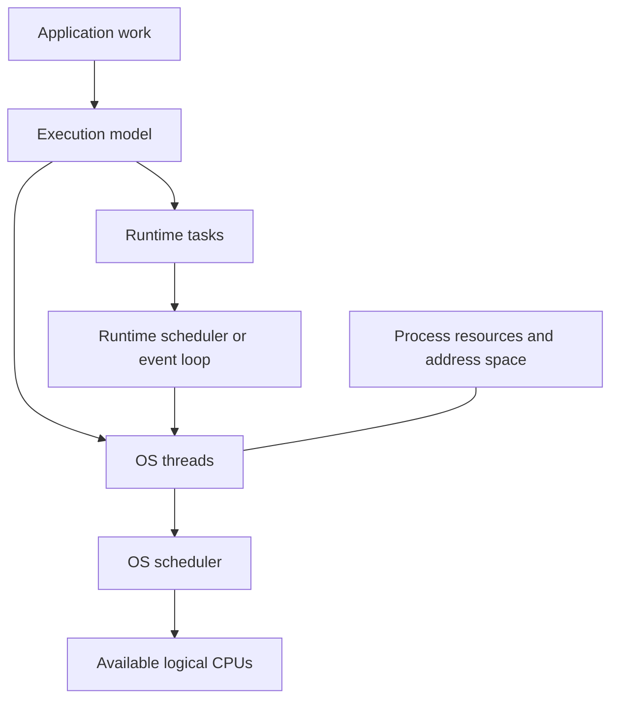
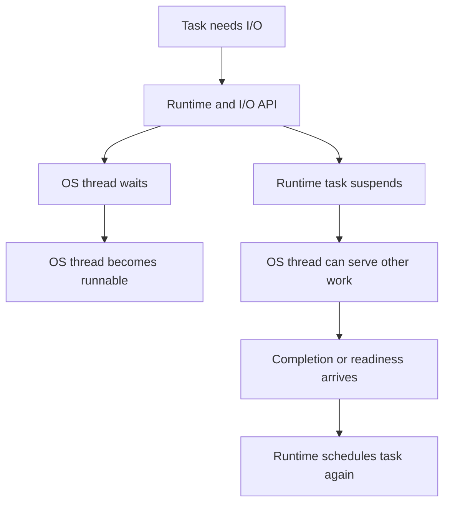

# Concept Map

[Home](README.md) · [Roadmap](ROADMAP.md) · [First lesson](01-fundamentals/01-processes-and-threads.md)

This map is the learning model for the handbook. It separates OS resources, runtime scheduling, programming interfaces, and observable behavior. It is not a claim that all runtimes use the same implementation.

## From application work to CPU execution

A task might be a request, callback, goroutine, or virtual thread. It is not necessarily an OS thread. The runtime determines how its tasks use OS threads; the OS schedules those threads onto available logical CPUs. CPU affinity, quotas, competing work, and blocking all affect actual execution.

## Terms that answer different questions

| Concept | Question it answers | Does not establish by itself |
| --- | --- | --- |
| Process | Which execution environment and resource/address-space boundary contains the work? | One process equals one thread |
| OS thread | Which schedulable execution context runs instructions? | A dedicated CPU or private heap |
| Multithreading | Does a process have multiple threads of execution? | Simultaneous execution |
| Concurrency | Can multiple activities make progress over an overlapping period? | Multiple CPUs executing those activities at once |
| Parallelism | Are activities executing simultaneously? | That the application is faster |
| Asynchronous programming | Can initiation and completion be handled separately? | Parallel execution or a nonblocking implementation at every layer |
| Nonblocking I/O | Can the operation return instead of waiting for readiness/completion? | A complete asynchronous programming model |
| Synchronization | What coordinates access and establishes required ordering/visibility? | That all shared state needs one global lock |
| Backpressure | How does limited downstream capacity constrain upstream production? | That an unbounded queue solves overload |

These are conceptual distinctions. Their complete lessons are listed in the [roadmap](ROADMAP.md).

## Waiting is different from executing

The alternatives depend on the API, runtime, and operation. Suspending a runtime task may allow an underlying OS thread to do other work. A blocking call may instead keep that OS thread occupied. Neither outcome means a database connection or another external resource has been released.

## Resource limits form separate budgets

For a database-backed request, track at least four different quantities: application tasks, executing OS threads, checked-out database connections, and queries in progress at the server. None is a general substitute for the others.

For example, 20 Java carrier threads do not by themselves imply at most 20 in-flight database queries. If virtual threads unmount while waiting on supported I/O, carriers can run other virtual threads while earlier queries remain in progress. A connection pool and the database still impose their own limits. Some operations may retain a carrier; details depend on the JDK and operation. See the official [Java virtual-thread guide](https://docs.oracle.com/en/java/javase/21/core/virtual-threads.html) and the planned Java mapping in the roadmap.

## How the layers connect

| Foundation | Core question | Language mapping | Experiment |
| --- | --- | --- | --- |
| Processes and threads | What is shared, and what executes? | Platform threads, runtime tasks, workers | Race conditions |
| CPUs and scheduling | Is work runnable, running, or waiting? | Runtime schedulers and execution contexts | CPU vs I/O; starvation |
| Memory and switching | What must be coordinated and made visible? | Locks, atomics, publication rules | Synchronization |
| Blocking and nonblocking I/O | Who waits, and what can be reused? | Virtual threads, goroutines, futures, event loops | Pool saturation; event-loop blocking |
| I/O multiplexing | How can few threads manage many waiting connections? | Event-driven and reactive designs | Cancellation and backpressure |

Read left to right to explain a specific mechanism. Read the [curriculum](ROADMAP.md) top to bottom for the full learning sequence.
